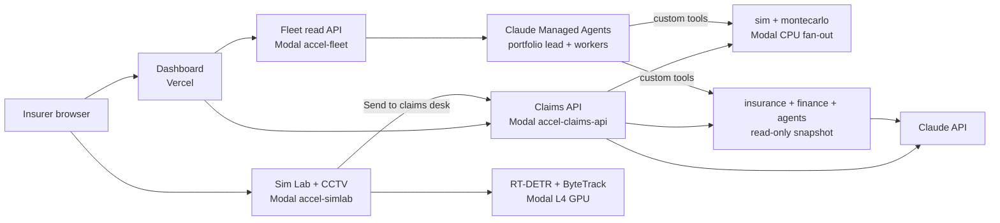
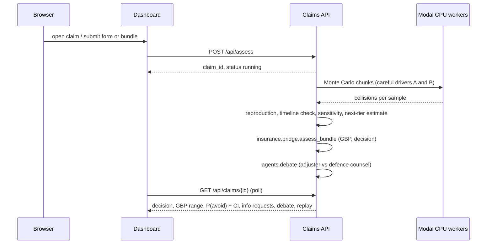

# How the Recovery Engine is wired

Every connection in the system: which service runs what, how it authenticates, which route calls what, and where data ends up.

## The big picture



| Service | What it does | Code |
|---|---|---|
| **Dashboard** (Vercel `accel-claims-dashboard`) | Inbox, intake, claim page, agent-run page, 3D replay | `viz/dashboard/` |
| **Claims API** (Modal `accel-claims-api`) | Assess a claim: sim, GBP, debate, information requests | `viz/api/` |
| **Sim Lab** (Modal `accel-simlab`) | Manual Monte Carlo panel, CCTV upload and measurement, 3D viewer | `viz/lab/`, `sim/video/` |
| **Fleet** (Modal `accel-fleet`) | Long-running Managed Agents run over the claims queue, trace API | `fleet/` |
| **Claude Managed Agents** | Portfolio lead (`claude-opus-5-5`) + Investigator, Reconstructor, Counterfactual analyst (`claude-sonnet-5-5`) | `fleet/agents/` |
| **Claude API** | Investigator intake (`claude-sonnet-5-5`); adjuster / defence counsel debate (insurance team's `agents/`) | `viz/api/claims.py`, `agents/` (insurance branch) |

## One claim, end to end



About 25 s for one claim.

## Routes

### Claims API (`termvato--accel-claims-api-web.us-east.modal.run`)
- `POST /api/assess`: `{bundle}` or `{form}`; returns `{claim_id, status}`, runs in the background.
- `GET /api/claims`, `GET /api/claims/{id}`: inbox rows, one result.
- `GET /api/examples`, `POST /api/examples/{id}/assess`: demo claims + insurance team examples.
- `GET /api/replay/{id}`: 3D viewer JSON.
- `POST /api/investigate`: narrative to structured fields (Claude; narrative treated as untrusted data).
- `POST /api/debate`, `GET /api/debate/{id}`: live debate, falls back to a labelled scripted one.
- `GET /api/health`.

### Sim Lab (`termvato--accel-simlab-web.us-east.modal.run`)
- `/`: manual ranges and drivers. `POST /api/run`, `GET /api/meta`.
- `/cctv`: `POST /api/video/upload`, `POST /api/video/{vid}/analyze`, `GET /api/video/{vid}/status|tracks|frame0.jpg|track/{tid}.jpg`, `GET /api/bundle/{vid}/{rid}`, `GET /api/replay/{vid}/{rid}`, `DELETE /api/video/{vid}`.
- Detection runs in `detect_video` on an L4 GPU.

### Fleet read API (`termvato--accel-fleet-web.us-east.modal.run`)
- `GET /api/runs`, `GET /api/runs/{id}`, `GET /api/runs/{id}/trace?since=N`, `GET /api/runs/{id}/portfolio`.
- Start a run: `modal run fleet/runner.py::start --claims 40 --budget-usd 25`.

## Authentication

| Connection | How | Where the secret lives |
|---|---|---|
| Modal apps → Claude / Managed Agents | `ANTHROPIC_API_KEY` | Modal secret `anthropic`, attached per function, never logged |
| Dashboard → Claude | Not used: the dashboard calls the Claims API, which holds the key | none on Vercel |
| Dashboard → APIs | Public HTTPS, CORS; no auth (demo) | `NEXT_PUBLIC_API_BASE`, `NEXT_PUBLIC_FLEET_API` in Vercel env |
| Sim Lab, Claims API | Unauthenticated public URLs (demo) | none |
| Insurance team code | Read-only `git archive origin/insurance insurance finance agents` at deploy, baked into the image | not in git on `sim` |

## Data

| Store | Contents |
|---|---|
| Modal Dict `accel-claims-store` | Claim results by id |
| Volume `accel-video` | Uploaded clips, tracks, bundles, replays (`uploads/<vid>/`); delete via the API |
| Volume `accel-fleet` | `runs/<id>/meta.json, trace.jsonl, portfolio.json` |
| Volume `accel-data` | TGSIM trajectories (FHWA, public domain) and extracted near-miss events; NGSIM clip (CC BY-SA 4.0) |
| Volume `accel-isaac` | Isaac Sim backup renders |
| `fleet/data/demo_claims.json` | 3 self-consistent synthetic demo claims |

## Where to change things

| To change… | Edit |
|---|---|
| Careful-driver models (UN R157 Annex 3) | `sim/policies/careful_a.py`, `careful_b.py`; review table `sim/policies/R157_ANNEX3.md` |
| Evidence → ranges, tiers, priors | `montecarlo/evidence.py` |
| Claim result fields | `montecarlo/estimate.py`, `viz/api/claims.py` |
| Agent prompts and roster | `fleet/agents/*.md`, `roster.json`; then `modal run fleet/runner.py::setup` |
| Demo claims | `fleet/demo_claims.py` |
| 3D replay look | `viz/web/index.html` (copied into the dashboard at build) |
| Legal wording and limits | `sim/LEGAL_BASIS.md` |

## Public demo switch (live runs paused)

The public demo is read-only by default so visitors can't run up costs.

| App | Paused when `ACCEL_LIVE_RUNS` is not `1` | Still works |
|---|---|---|
| Claims API | every POST/PUT/DELETE: assess, investigate (Claude), debate (Claude), reprice, profiles | stored claims, replays, examples, health |
| Sim Lab | every POST/DELETE: Monte Carlo runs, CCTV upload, GPU analysis, claim hand-off | pages, video status, frames, tracks, thumbnails |

- **When paused,** those routes return HTTP 403 with `{"paused": true, "detail": ...}`. The guided tour still works: it uses stored results.
- **Fleet:** runs only start from the CLI (`modal run fleet/runner.py::start`), so the public read API is already safe.

**Reconnect** (redeploy with the flag set):
```bash
ACCEL_LIVE_RUNS=1 .venv/bin/modal deploy viz/api/app.py
ACCEL_LIVE_RUNS=1 .venv/bin/modal deploy viz/lab/app.py
```
**Pause again:** deploy without the flag.
