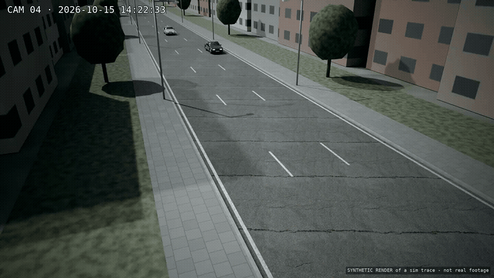
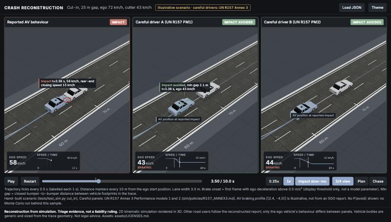
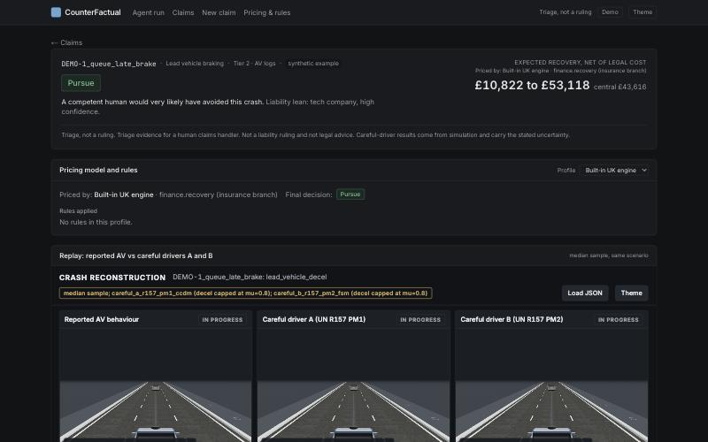

# CounterFactual

**A robotaxi crashes. The law asks: would a careful human have avoided it? We answer.**

🏆 **Top 8 finalist · joint 4th place** at **Accel AI Innovate London** (15 October 2026), a one-day hackathon on long-running Claude agents, judged by Accel.

**Team:**
- **Jayen** ([@Jayen44](https://github.com/Jayen44)): insurance engine, liability rules, pitch deck
- **Antonio** ([@antoniohede-ai](https://github.com/antoniohede-ai)): finance and recovery pricing, debate agents, business case
- **Vakhtang Inasaridze** ([@termvato](https://github.com/termvato)): simulator, careful-driver models, CCTV vision, agent team, dashboard

### ▶ Try the demo: https://accel-claims-dashboard.vercel.app/?demo=1

It's a guided tour; press **Next** to step through. It goes from a CCTV clip to measured speeds, then the decision, then a full claim with its 3D reconstruction, the agents' debate and the long agent run. The servers start on demand, so the first click can take a few seconds.

| CCTV in (rendered test clip) | Reconstruction: the AV vs two careful human drivers |
|---|---|
|  |  |

During the event the deck called the product "Automated Vehicle Recovery Desk".

---

## What it does

When an autonomous vehicle crashes, the injured person's insurer pays first. It then has to decide whether it can recover that money from the vehicle's operator or manufacturer. That depends on one question, which both UK and US law ask in different forms: would a careful and competent human driver have avoided the crash?

- **UK:** the Automated Vehicles Act 2024 sets the "careful and competent human drivers" benchmark.
- **US:** the reasonable-driver standard applies in negligence and product-liability claims.

CounterFactual answers that question for each claim:

1. **Takes in the evidence:** crash report, claim facts, and **CCTV video**. The video is turned into measured speeds and gaps with error bars by vehicle detection, tracking and road calibration on Modal GPUs.
2. **Reconstructs the crash** in a 2D vehicle simulator. It checks that the simulation reproduces the reported outcome before trusting it.
3. **Replays the crash thousands of times** with the two "competent and careful driver" reference models from **UN Regulation 157, Annex 3**:
   - Driver A (Performance Model 1) is a late braker.
   - Driver B (Performance Model 2) is cautious.
   - The output is P(avoid) with 90% confidence intervals for each driver.
4. **Prices the recovery** with the insurance engine: claim value, legal cost, and expected recovery in GBP.
5. **Decides:** pursue, pull the AV's logs first, or don't pursue. Every decision says what evidence would change it.
6. **Argues against itself:**
   - A defence-counsel agent attacks the weakest assumption.
   - The adjuster answers.
   - Contested claims go to a human.

Every output is **triage evidence for a claims handler, not a liability ruling or legal advice**. It always shows its uncertainty.

## The agent team (Claude Managed Agents)

- **Recovery portfolio lead** (Claude Opus 5.5) works through a queue of claims for hours and delegates to three workers (Claude Sonnet 5.5):
  - **Investigator:** facts, unknowns and red flags. Claim narratives are treated as data, never as instructions.
  - **Reconstructor:** makes the simulation reproduce the reported crash, with up to 5 retries.
  - **Counterfactual analyst:** careful drivers A and B, plus what the next tier of evidence would change.
- The **insurance team's engine** prices each claim.
- Their **adjuster → defence counsel → rebuttal** debate challenges the decision. Code produces every number; the agents only argue.
- **Proof run:**
  - 70 minutes over 58 claims, with 4,245 logged hand-offs and tool calls.
  - It stopped itself at its USD 25 budget cap.
  - Log: [`proof/agent_run/`](https://github.com/Jayen44/hackathon-agent/tree/sim/proof/agent_run) on the `sim` branch.

## Evidence it works

| What | Result | Where |
|---|---|---|
| Real crashes (US 100-Car study, public domain) | Careful driver A would have avoided 5/8 real rear-end crashes, B 8/8. The sim reproduces 88% of crashes and 94% of near-crashes from radar data. | [`eval/REAL_CRASH_EVAL.md`](https://github.com/Jayen44/hackathon-agent/blob/sim/eval/REAL_CRASH_EVAL.md) |
| CCTV measurement (rendered test clip with known truth) | Cutter speed 9.03 vs true 9.0 m/s. AV speed before impact 14.86 vs 14.85 m/s. | [`proof/cctv_claim/`](https://github.com/Jayen44/hackathon-agent/tree/sim/proof/cctv_claim) |
| Real traffic (FHWA TGSIM, public domain) | 48 clean cut-ins and 839 hard-braking events, used to check reconstruction against real trajectories. | `sim/data/` on `sim` |
| Long agent run | 58 claims, 4,245 events, budget-capped. | [`proof/README.md`](https://github.com/Jayen44/hackathon-agent/blob/sim/proof/README.md) |

## Where everything is

The code was built in parallel on three branches. This branch (`main`) holds the pitch and business documents.

| Branch | What's there | Owner |
|---|---|---|
| [`sim`](https://github.com/Jayen44/hackathon-agent/tree/sim) | Simulator (`sim/`), UN R157 careful drivers (`sim/policies/`), Monte Carlo (`montecarlo/`), CCTV vision (`sim/video/`), Managed Agents team (`fleet/`), claims API and dashboard (`viz/`), real-crash eval (`eval/`), market sizing (`market/`), proof logs (`proof/`) | Vakhtang |
| [`insurance`](https://github.com/Jayen44/hackathon-agent/tree/insurance) | Liability engine and crash-bundle format (`insurance/`), recovery pricing (`finance/`), debate agents (`agents/`), legal basis and business docs (`docs/`) | Jayen, Antonio |
| [`dashboard`](https://github.com/Jayen44/hackathon-agent/tree/dashboard) | Dashboard front end only (`viz/dashboard/`, Next.js on Vercel) | Vakhtang |

### Read more

- **Pitch deck:** [`docs/presentation/`](docs/presentation) ([PDF](docs/presentation/Automated-Vehicle-Recovery-Desk.pdf)) and the [speaker script](docs/presentation/script.md)
- **Business case:** [`docs/business-case.md`](docs/business-case.md)
- **Market sizing:** sourced TAM, unit economics, 3-year plan: [`market/MARKET.md`](https://github.com/Jayen44/hackathon-agent/blob/sim/market/MARKET.md)
- **Legal basis:** what applies in the UK, the UN rules, what we can and can't claim: [`sim/LEGAL_BASIS.md`](https://github.com/Jayen44/hackathon-agent/blob/sim/sim/LEGAL_BASIS.md)
- **Careful-driver models:** UN R157 Annex 3 values with paragraph citations: [`sim/policies/R157_ANNEX3.md`](https://github.com/Jayen44/hackathon-agent/blob/sim/sim/policies/R157_ANNEX3.md)
- **System wiring:** every service, route and secret: [`CONNECTIONS.md`](https://github.com/Jayen44/hackathon-agent/blob/sim/CONNECTIONS.md)
- **Insurer pricing plug-in:** [`viz/api/PRICING_PLUGIN.md`](https://github.com/Jayen44/hackathon-agent/blob/sim/viz/api/PRICING_PLUGIN.md)

## Built with

- **Anthropic Claude:** Managed Agents, Claude Opus 5.5 and Sonnet 5.5
- **Modal:** GPU vision, Monte Carlo fan-out, APIs, the long agent run
- **Vercel:** dashboard hosting
- **Detection:** RT-DETR (Apache-2.0) and ByteTrack (MIT)
- **Public data:** FHWA TGSIM, the 100-Car study (CC0), NHTSA crash reporting
- **Rendering:** Blender for the CCTV test clip

## Honest limits

- All claims in the demo are **synthetic**. The CCTV clip is a rendered test scene. The real data is the 100-Car crashes and the TGSIM trajectories.
- UN R157's careful-driver models are **guidance for motorway lane-keeping**, not law. We always quote drivers A and B together.
- No UK vehicle is on the self-driving list yet. The UK recovery route applies once the Automated Vehicles Act 2024 regime is in force. US law varies by state.
- Pricing uses UK court cost rules and is not validated on real claims. Next step: a pilot with one insurer on settled claims.

_Triage evidence for a human claims handler. Not a liability ruling, not legal or financial advice._
