# Pitch deck: Automated Vehicle Recovery Desk

11 slides, about 5 minutes, United States first (decision #32).

- **Present it live (with speaker notes):** [Claude Slides artifact](https://claude.ai/artifact/Q96PgYWxN8CTCcgpCuNbcP)
- **Speaker script (5 minutes, who says what):** [script.md](script.md) · [PDF](script.pdf)
- **Download:** [PDF](Automated-Vehicle-Recovery-Desk.pdf)
- **Open offline:** download [`deck.html`](deck.html) and open it in a browser (arrow keys move between slides; print for one slide per page)

The slides are shown below as images so they display on GitHub.

### 1. Cover

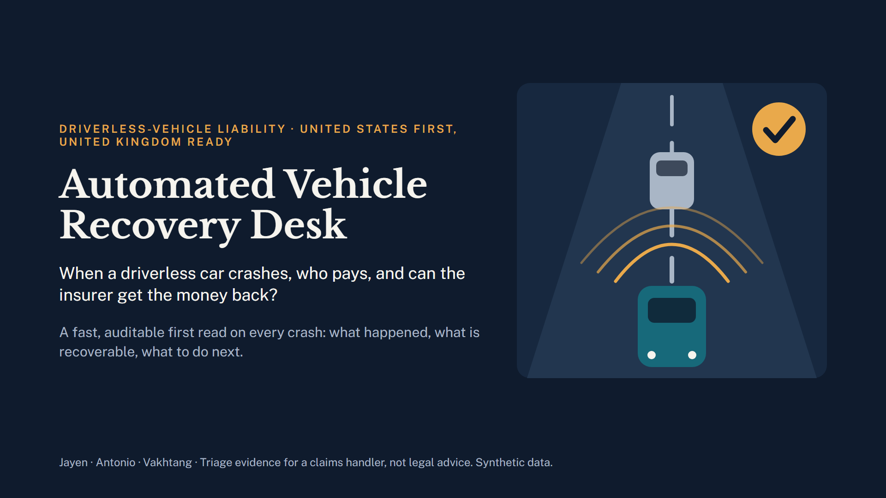

### 2. Why it is needed

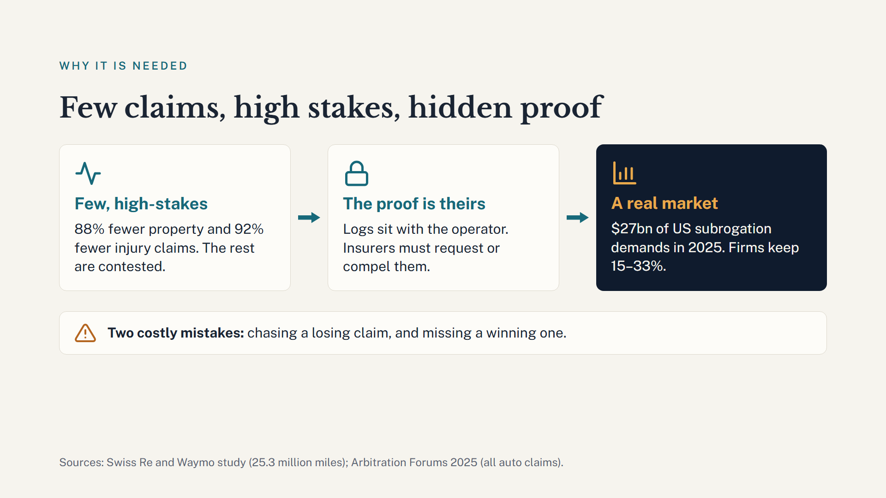

### 3. Target market

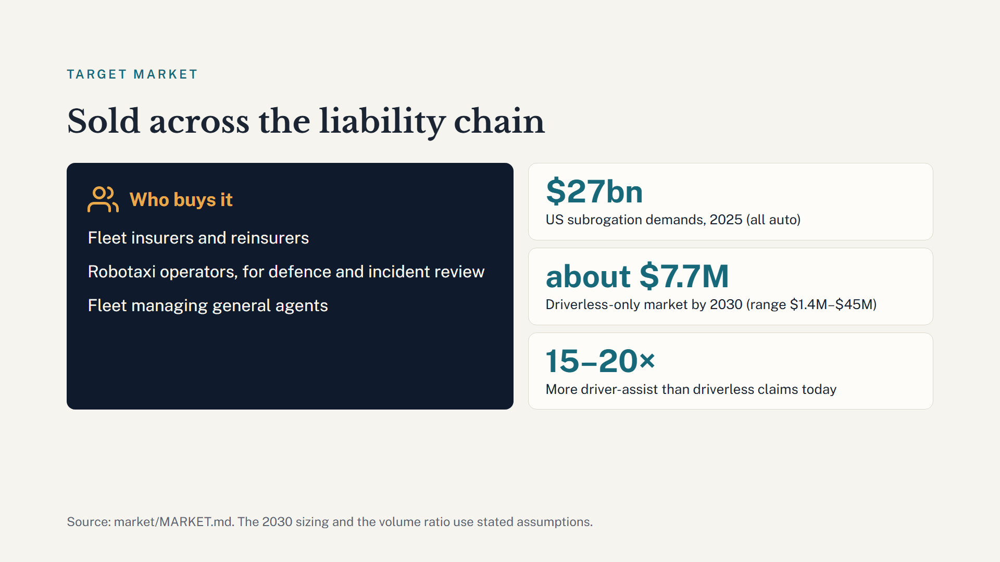

### 4. Why start in the United States

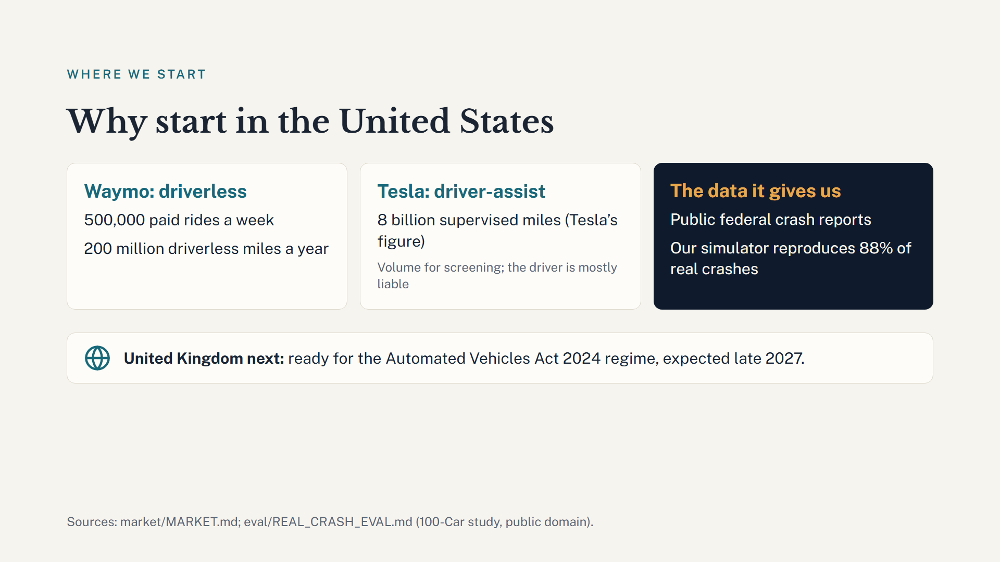

### 5. One claim, start to finish

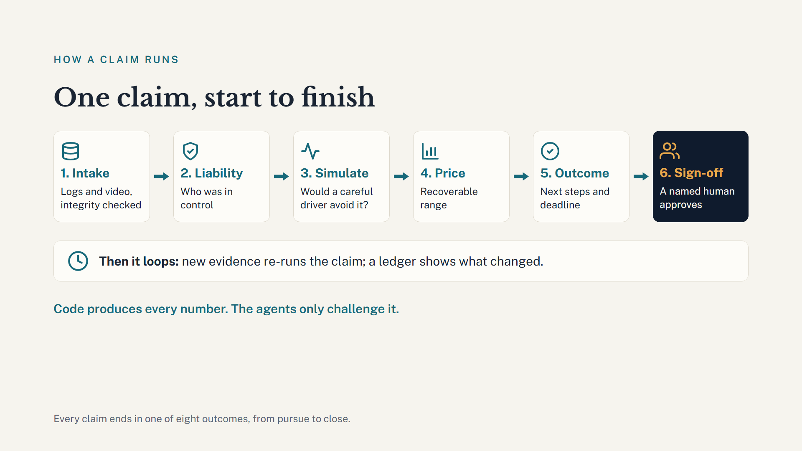

### 6. Four agents, built to run for hours

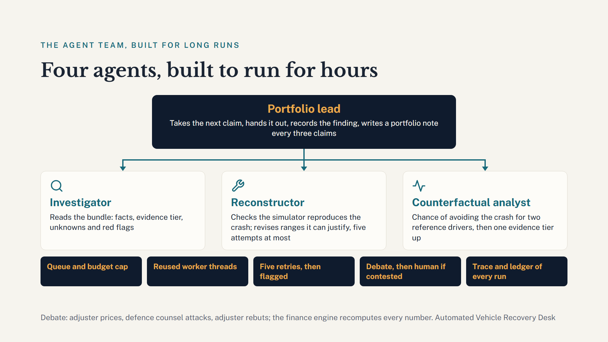

### 7. Cue the demo

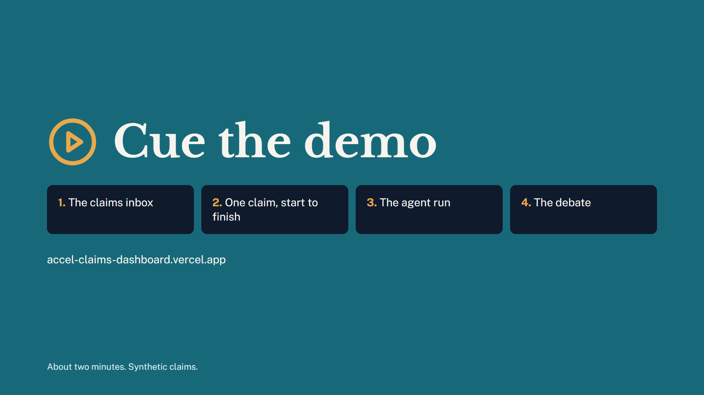

### 8. Three ways to charge

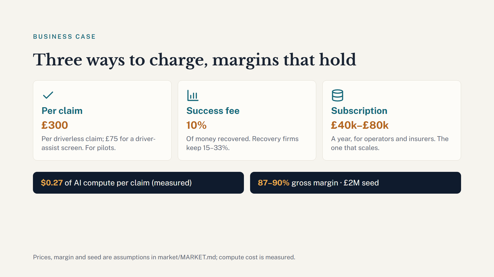

### 9. Risks, and how we address each

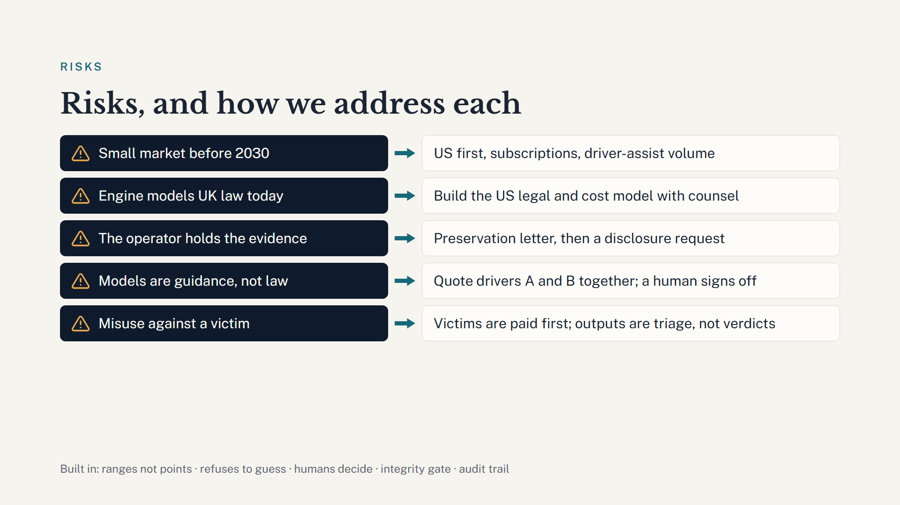

### 10. Ready for real claims (the ask)

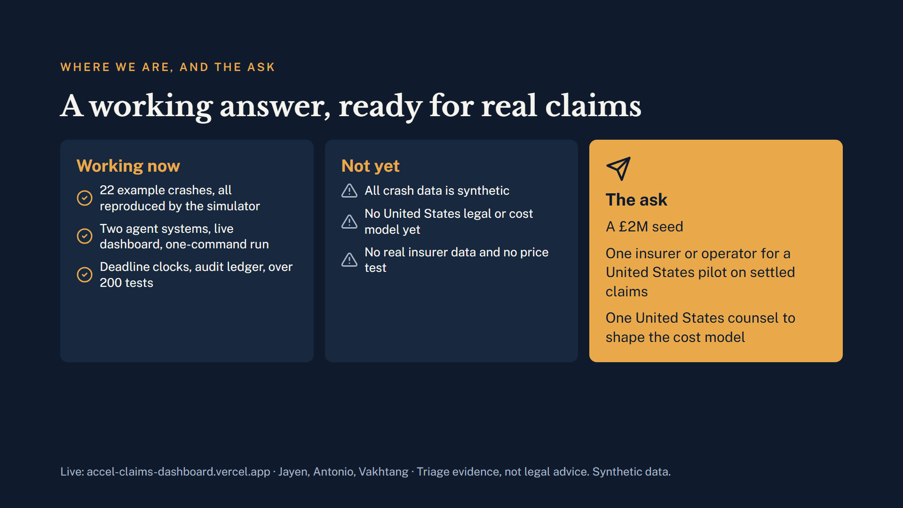


### 11. Any questions?

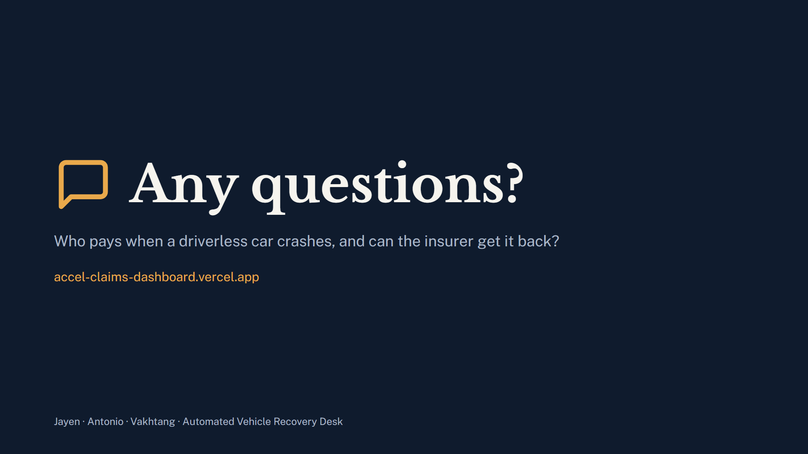

---

**Source and rebuilding.** `deck.json` (order and sections) and `slides/*.html` are the deck source in the Slides-artifact format.
After editing them, run `python build_deck.py docs/presentation` to rebuild `deck.html`, then re-render the images and PDF with
headless Chrome, for example:

```
chrome --headless=new --window-size=1920,1080 --virtual-time-budget=6000 --screenshot=images/slide-01.png "file:///<path>/deck.html?slide=1"
chrome --headless=new --virtual-time-budget=6000 --no-pdf-header-footer --print-to-pdf=Automated-Vehicle-Recovery-Desk.pdf "file:///<path>/deck.html"
```

**Wording rules (#32):** say "recovery case" and "triage evidence"; never call a named company "liable" or "defective"; quote careful
drivers A and B together. Figures come from `market/MARKET.md` (branch `sim`); prices, shares and the plan are assumptions and the slides
say so. `pitch-outline.md` holds the earlier long-form outline and the marking-scheme mapping.
